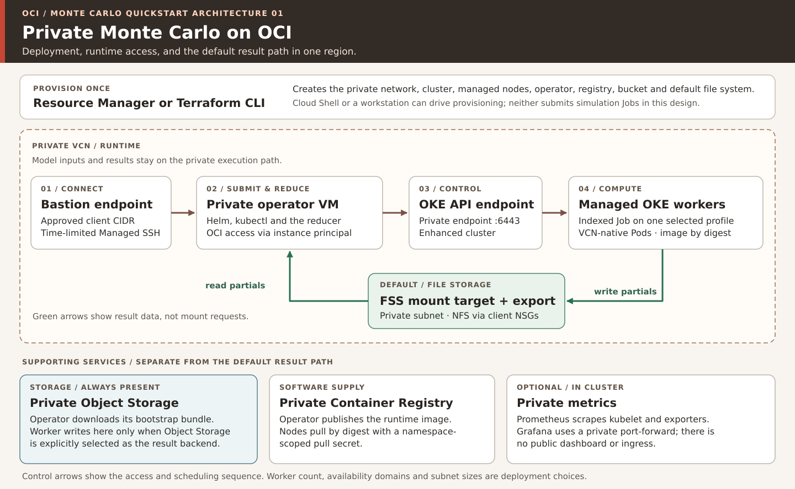

# OCI Monte Carlo Quickstart

Deploy and run secure, repeatable Monte Carlo derivative-pricing and synthetic insurance-savings examples on OCI.

The quickstart creates a private OKE environment for the workers and a private operator VM for the person running the workload. It produces a reproducible estimate, a confidence interval, and the execution evidence needed to understand what produced it.

## Architecture



Follow the green path: each worker writes one partial under `/results`. The operator reads the **same files** under `/mnt/mcqs-results` and combines them. No copy through Object Storage is needed. The private bucket shown in the diagram delivers the operator's bootstrap bundle; it stores simulation results only when you select Object Storage delivery instead.

[Architecture guide](docs/architecture.md) · [Compare the two result paths](docs/result-delivery.svg) · [Download the overview for slides (PNG)](docs/architecture.png)

## Start here

There are two places to work. Keeping them separate is intentional.

| Stage | Where you work | What you do |
|---|---|---|
| Provision infrastructure | OCI Cloud Shell, workstation, or CI | Discover live OCI choices, build the Resource Manager archive, and provision the private environment. |
| Run simulations | Private operator VM through OCI Bastion | Build and publish the image, configure the pull secret, submit jobs, and read results. |

Cloud Shell is optional. Resource Manager creates infrastructure only; it does not connect to the private Kubernetes API or submit workloads.

## What is deployed

- Private enhanced OKE cluster, private worker nodes, and VCN-native pod networking.
- Private Compute operator VM with OCI Bastion Managed SSH access; it has no public IP.
- Private OCIR repository, a private versioned Object Storage bucket for bootstrap delivery, and private FSS result delivery by default.
- A Helm runtime baseline with a restricted Pod Security policy, NetworkPolicy, resource limits, and a baseline-owned ServiceAccount.
- Indexed Kubernetes Jobs that write immutable partial results either with OKE Workload Identity to Object Storage or to a private FSS share.
- A local operator-side reducer that validates the partial results and calculates the final estimate.

## The Monte Carlo example

The supplied example prices a one-year **European call option**. It asks: *what is the value today of the right to buy an asset for 100 in one year, when the asset is currently 102?*

For each simulated market path, the engine evolves the price with geometric Brownian motion, calculates the payoff at expiry, and discounts it to today:

It averages many discounted payoffs to estimate the option value. The sample uses 200,000 paths, 32 time steps, a fixed seed, and antithetic paths (each random shock is paired with its inverse) to reduce statistical noise without changing the financial model.

The input is [examples/sample-simulation.json](examples/sample-simulation.json). Its important fields are:

| Field | Meaning |
|---|---|
| `spot`, `strike` | Asset price today and option exercise price. |
| `risk_free_rate`, `dividend_yield` | Rates used for the price drift and discounting. |
| `volatility` | Assumed annualized uncertainty of the asset price. |
| `maturity_years` | Time to expiry. |
| `simulations` | Total number of paths. More paths normally narrow the confidence interval. |
| `steps` | Time slices in each simulated path. |
| `seed` | Makes a chosen execution layout repeatable. |

`--parallelism` divides the fixed total number of paths across Indexed Job partitions. It is a throughput control, not an accuracy control: use more `simulations` when you need a tighter estimate, and more parallelism when the cluster has capacity to finish the same work sooner.

## Read the result

`./operator/run-example.sh --parallelism 4` waits for the job and prints JSON similar to:

```json
{
  "price": 12.37215463741667,
  "confidence_interval": [12.290717037763079, 12.453592237070263],
  "confidence_level": 0.95,
  "standard_error": 0.04155055924375422,
  "simulations": 200000,
  "partitions": 4
}
```

- **`price`** is the estimated present value under the model assumptions, approximately **12.37** for the sample.
- **`confidence_interval`** is the sampling interval. A 95% interval means that, over many independent Monte Carlo experiments built the same way, 95% of those intervals would contain the model’s true expected value. It is not a 95% probability statement about tomorrow’s market price.
- **`standard_error`** measures Monte Carlo sampling uncertainty. Roughly speaking, doubling the number of simulations reduces it by about \(\sqrt{2}\), not by two.
- **`sample_standard_deviation`** describes payoff dispersion across the simulated paths. It is different from the input market volatility.
- **`simulations`** and **`partitions`** confirm the amount of work and the execution layout.
- **`input_sha256`** binds the displayed result to one canonical simulation input. The reducer accepts only one run ID, one input hash, and exactly one result from every expected partition.
- **`total_worker_seconds`** is the sum of worker compute time. It is useful for benchmarking; it is not elapsed wall-clock duration.

The output validates numerical uncertainty under this model. It does not validate market assumptions, liquidity, calibration, or suitability for a trading decision.

## Choose result delivery

The default **FSS** mode writes each partition result to a private OCI File Storage export shared by the worker nodes and private operator. Terraform creates the filesystem, a dedicated mount-target subnet, and the required network rules; the runtime creates a static FSS PV/PVC that every simulation run mounts. Worker Pods do not receive an Object Storage workload-identity token, and the operator aggregates results from the mounted export.

Choose **Object Storage** (`result_delivery_mode = "object_storage"` in Resource Manager) when a platform design prefers write-once result objects in a private bucket. In that mode, the worker uses a workload identity constrained to the configured result prefix and the operator validates the complete partition set.

FSS is a good foundation for workloads that later need shared reference data, larger checkpoint files, or a parallel-filesystem design. This quickstart uses it only for small immutable partial results, so it remains valid to retain Object Storage for economical long-term archival and cross-region reporting.

If changing an existing environment to FSS, increment `operator_bootstrap_generation` with the Terraform update. This replaces the operator so its bootstrap can install the NFS client and mount the new export.

## Synthetic insurance-savings example

The quickstart also includes a simple ten-year **savings policy with insurance cover**. Think of it as a savings account funded by an initial payment and monthly payments. The balance is invested, so it can rise or fall. A small fee is taken from the balance. The policy can end early if the customer dies or withdraws their money. If it reaches the end of ten years, the customer receives the higher of the investment balance and a promised minimum amount.

The supplied figures are fictional so that you can safely change them and see how the result responds.

For every simulated policy, the model asks: *what investment return happened, did the policy end early, and what payment was made?* It runs that story many times and averages the answers.

```bash
./operator/run-insurance-savings.sh --parallelism 4
```

The runner displays live partition and Pod progress while it waits. It is normal for the bar to stay at `0%` while every worker is calculating: a partition is counted only when it has written its completed immutable result. Use `--progress-interval 10` for less-frequent updates, or submit without waiting and monitor from the shell:

```bash
./operator/run-insurance-savings.sh --parallelism 4 --no-wait
./operator/watch-run.sh --job '<job-name>' --run-id '<run-id>' --partitions 4
```

The result shows the average value of customer payments, premiums received, and running costs. It also shows **net liability**: customer payments plus costs, minus premiums received. A positive number means that, under the chosen assumptions, payments and costs are greater than premiums.

It also reports the chance that a policy reaches the end, ends through withdrawal, ends through a death claim, or needs a top-up because the promised minimum is higher than the investment balance. See the [insurance-savings example guide](docs/insurance-savings-example.md) for a plain-language explanation of every input and output, plus a nine-scenario stress grid.

### Compare worker-shape throughput

The same synthetic insurance-savings workload is also the project's repeatable Compute benchmark. Start with the strict OCI-OCPU comparison: every worker reserves the same CPU and memory, every profile uses exactly two nodes, and host placement is balanced automatically.

Run all selected benchmark profiles in the background:

```bash
./operator/run-strict-ocpu-suite.sh --background
```

The command discovers configured profiles, checks allocatable capacity and, in FSS mode, verifies worker mounts, runs profiles one at a time, and writes one private JSON and CSV report. Follow progress after reconnecting:

```bash
./operator/benchmark-suite-status.sh --suite-id <suite-id> --follow
```

For one profile, use:

```bash
./operator/run-strict-ocpu-benchmark.sh --profile-id e6-flex
```

Both strict commands use the 100-million-policy input and reserve `2` Kubernetes CPUs and `4Gi` per worker. The suite defaults to four workers and five measured runs; the single-profile command defaults to six workers and seven measured runs. Each uses one warm-up. Set `--parallelism` and `--measured-runs` explicitly to compare the two reports on equal terms.

The standard application-policy benchmark remains available when you specifically want to measure the default workload configuration. Its default is a fifty-million-policy version of the same fixed-seed policy projection:

```bash
./operator/run-benchmark.sh \
  --profile-id e6-flex \
  --architecture amd64 \
  --parallelism 4
```

With the default FSS result-delivery mode, the benchmark first confirms that the selected two-node pool can pull the immutable image and mount, write to, and release the private results share. This preflight is outside the measured run, so a storage or node-readiness condition is reported before benchmark timing begins.

See [Shape benchmarking](docs/shape-benchmarking.md) for fair-comparison controls, optional Terraform-managed dedicated node pools with profile labels and taints, OKE autoscaling bounds, multi-architecture testing, and result interpretation.

For several selected benchmark profiles, `operator/run-benchmark-suite.sh --background` runs one profile at a time and writes a consolidated JSON and CSV report. Use `operator/benchmark-suite-status.sh --suite-id <suite-id> --follow` from a separate Bastion session to see its progress.

The suite is detached from the Bastion session and continues after a disconnect. Use `operator/stop-benchmark-suite.sh --suite-id <suite-id>` only when you intentionally want to stop the active profile; completed profile reports are retained.

### Run a complete scaling study

For capacity planning, use the detached scaling study instead of comparing one parallelism setting. It measures fixed-work **strong scaling**, fixed-work-per-worker **weak scaling**, and the throughput-saturation point for every selected profile. It writes a consolidated JSON and CSV report while preserving every individual benchmark report:

```bash
STUDY_ID="insurance-scaling-$(date -u +%Y%m%d%H%M%S)"

./operator/run-scaling-study.sh \
  --background \
  --study-id "$STUDY_ID" \
  --profiles e6-flex,e6-acceleron,a4-acceleron \
  --parallelism-levels 2,4,6,8 \
  --warmup-runs 1 \
  --measured-runs 7
```

Follow it after reconnecting at any time:

```bash
./operator/scaling-study-status.sh --study-id "$STUDY_ID" --follow
```

The runner processes one profile and one test point at a time, so shared cluster, registry, and FSS activity does not invalidate the comparison. See [Scaling studies](docs/shape-benchmarking.md#run-a-complete-scaling-study) for the test design, expected duration, outputs, and interpretation.

## Guided deployment

### 1. Choose a live-compatible OKE configuration

From the provisioning plane, clone the repository and query the target tenancy. OCI’s live response is the source of truth for shape capacity, OKE versions, and node images. Shape capacity is Availability-Domain-specific; OKE node images are selected for the region, Kubernetes version, and CPU architecture.

```bash
git clone <your-repository-url> oci-monte-carlo-quickstart
cd oci-monte-carlo-quickstart

export REGION="us-ashburn-1"

# Use the exact AD name returned for the target region, then copy it here.
oci iam availability-domain list \
  --compartment-id "$TENANCY_OCID" \
  --region "$REGION" \
  --query 'data[].name' --output table

export WORKER_AD="<Availability-Domain-name>"

./provisioning/list-shapes.sh \
  --compartment-id "$COMPARTMENT_OCID" \
  --region "$REGION" \
  --availability-domain "$WORKER_AD"
./provisioning/list-oke-options.sh \
  --compartment-id "$COMPARTMENT_OCID" \
  --region "$REGION"
```

Select a **full Kubernetes patch version** from the returned list, then select a node image for the same version and architecture. Both `kubernetes_version` and `node_image_id` are required Resource Manager inputs; neither has a deployment default.

```bash
export NODE_SHAPE="VM.Standard.E6.Flex"
export KUBERNETES_VERSION="<full-version-returned-by-OCI>"
export NODE_ARCHITECTURE="amd64"

./provisioning/list-oke-options.sh \
  --compartment-id "$COMPARTMENT_OCID" \
  --region "$REGION" \
  --node-shape "$NODE_SHAPE" \
  --architecture "$NODE_ARCHITECTURE" \
  --kubernetes-version "$KUBERNETES_VERSION"

export NODE_IMAGE_ID="ocid1.image..."

./provisioning/validate-oke-selection.sh \
  --compartment-id "$COMPARTMENT_OCID" \
  --region "$REGION" \
  --node-shape "$NODE_SHAPE" \
  --architecture "$NODE_ARCHITECTURE" \
  --kubernetes-version "$KUBERNETES_VERSION" \
  --node-image-id "$NODE_IMAGE_ID"
```

Use `amd64` for Intel and AMD workers, and `arm64` for Ampere workers. Do not reuse an image OCID across Kubernetes versions or architectures.

### 2. Provision with Resource Manager

Build the archive:

```bash
./provisioning/build-orm.sh
```

Upload `dist/orm.zip` to OCI Resource Manager and create a stack. In the form, provide the live-verified Kubernetes version, node image OCID, architecture, shape, worker Availability Domain, and sizing. Also provide a narrow `bastion_client_cidr`: the public CIDR of the workstation or corporate VPN that will create the Bastion session. For a single fixed public IPv4 address, use `/32`.

The stack records the initial placement of the private operator and FSS resources separately from the worker pools. A later worker-pool capacity move therefore leaves the operator and shared result storage in place. Set **Operator Availability Domain** or **File Storage Availability Domain** only when you want a specific placement from the start or an intentional relocation.

The Resource Manager form follows the same decision order as the deployment: configure the environment, select the primary worker shape, choose any optional managed-node benchmark shapes, then set shared benchmark capacity. The managed benchmark section uses explicit shape selections—AMD E5 Flex, AMD E6 Flex, AMD E6 Acceleron, Intel Optimized3 Flex, Intel Acceleron, and Ampere A4 Acceleron—instead of a raw configuration field.

For a field-by-field walkthrough, use the [Resource Manager input guide](docs/resource-manager-input-guide.md).

The form also exposes independent controls for each IAM policy and the operator dynamic group. Each control describes the access it grants, so a platform team can decide which resources this stack creates and which it manages separately. See the [Terraform guide](terraform/README.md#identity-and-policy-controls).

Keep the default `result_delivery_mode = fss` and retain a dedicated, non-overlapping `fss_subnet_cidr` (the default is `10.42.50.0/28`). The stack creates the FSS resources and writes the complete CSI volume configuration into the operator profile. In this mode the two Object Storage result policies are not created; Object Storage remains private and is still used to deliver the operator bootstrap bundle.

For a first deployment, choose `operator_kubernetes_access_mode = iam_admin`. It grants the operator OKE administration scoped to this quickstart cluster, so it can use Helm and kubectl. `namespace_rbac` is available for teams that want a separate administrator to apply the namespace-scoped binding once.

When the stack completes, create a Managed SSH session using the `operator_session_create_command` stack output. If needed, create an SSH key first:

```bash
mkdir -p ~/.ssh
test -f ~/.ssh/id_rsa.pub || ssh-keygen -t rsa -b 4096 -f ~/.ssh/id_rsa
```

The default Bastion session lifetime is three hours. Set `bastion_session_ttl_seconds` in Resource Manager to any whole value from 1,800 to 10,800 seconds, and set `bastion_ssh_public_key_file` if the generated command should use a different RSA public-key path.

Connect to the resulting Bastion session as `opc`.

### 3. Prepare the runtime on the private operator

Run these commands on the operator VM:

```bash
cd /home/opc/oci-monte-carlo-quickstart
source /etc/profile.d/mcqs-runtime.sh

./operator/doctor.sh
./operator/install-runtime.sh

# Use the OCI Console Profile-menu value, without the tenancy namespace.
# Federated example: oracleidentitycloudservice/your.name@example.com
export OCI_USER_NAME="<username-or-identity-domain/username>"

# Each command uses Docker's hidden password prompt for an OCIR auth token.
./operator/build-and-push.sh
./operator/create-pull-secret.sh
```

The default build follows the selected node architecture. Use `--multi-arch` only when you deliberately need one manifest for both `amd64` and `arm64`.

With the default FSS delivery path, `doctor.sh` confirms that the operator has mounted the private export and that OKE has the FSS CSI driver. `install-runtime.sh` creates the static PV/PVC before any simulation Job is submitted. FSS result files are write-once per partition; retain or archive completed run directories according to the organisation's data-retention policy.

### 4. Run and review the sample

```bash
./operator/run-example.sh --parallelism 4
./operator/status.sh
```

The script creates a unique run, waits for all partitions, and prints the aggregate automatically. To review a completed run again with a different confidence level:

```bash
./operator/aggregate-results.sh \
  --run-id '<completed-run-id>' \
  --expected-partitions 4 \
  --confidence 0.95
```

## Select a deployment profile

Start with E6 Flex. The other profiles are useful for an intentional architecture or Acceleron benchmark. Always confirm every shape in your target availability domain immediately before deployment.

| Profile | Node shape | Architecture | Use it when |
|---|---|---|---|
| [starter-amd.tfvars](profiles/starter-amd.tfvars) | `VM.Standard.E6.Flex` | `amd64` | You want the standard onboarding path. |
| [amd-e5.tfvars](profiles/amd-e5.tfvars) | `VM.Standard.E5.Flex` | `amd64` | You want an AMD E5 comparison profile. |
| [amd-acceleron.tfvars](profiles/amd-acceleron.tfvars) | `VM.Standard.E6.Ax.Flex` | `amd64` | You are comparing current AMD Acceleron nodes. |
| [intel-optimized3.tfvars](profiles/intel-optimized3.tfvars) | `VM.Optimized3.Flex` | `amd64` | You are testing an Intel optimized compute profile. |
| [intel-acceleron.tfvars](profiles/intel-acceleron.tfvars) | `VM.Standard4.Ax.Flex` | `amd64` | You are comparing Intel Acceleron nodes. |
| [arm-a2.tfvars](profiles/arm-a2.tfvars) | `VM.Standard.A2.Flex` | `arm64` | You want a current non-Acceleron Ampere path. |
| [arm-acceleron.tfvars](profiles/arm-acceleron.tfvars) | `VM.Standard.A4.Ax.Flex` | `arm64` | You are benchmarking Ampere Acceleron nodes. |
| [hpc-amd.tfvars](profiles/hpc-amd.tfvars) | `BM.HPC.E5.144` | `amd64` | You have confirmed OKE support, capacity, and cost approval. |

Copy the relevant values into the Resource Manager form or a local `terraform.tfvars`; profiles do not replace the required live OKE version and image selection.

## Collateral guide

| Need | Read or run |
|---|---|
| Understand the trust boundaries and component flow | [Architecture](docs/architecture.md) |
| Follow the end-to-end provisioning and operator sequence | [Provisioning and operator guide](docs/provisioning-and-operator.md) |
| Run additional derivative products and a market-risk sensitivity grid | [Financial examples](docs/financial-examples.md) |
| Run and interpret the synthetic insurance-savings workload and stress grid | [Insurance savings example](docs/insurance-savings-example.md) |
| Choose private Object Storage or FSS immutable result delivery | [FSS result delivery](docs/fss-result-delivery.md) |
| Compare OCI Compute shape throughput with the insurance-savings workload | [Shape benchmarking](docs/shape-benchmarking.md) |
| Inspect CPU, memory, pressure, and Kubernetes state privately | [Optional observability](docs/observability.md) |
| Demonstrate Kueue scheduling, autoscaled capacity, and worker recovery | [Grid, elastic capacity, and resilience](docs/grid-elastic-resilience.md) |
| Select a current CPU, HPC, or Acceleron shape | [Shape catalogue](docs/shape-catalog.md) and `provisioning/list-shapes.sh` |
| Explain the user journey and onboarding choices | [Human-centered design](docs/human-centered-design.md) |
| Review security assumptions and residual risks | [Threat model](docs/threat-model.md) and [SECURITY.md](SECURITY.md) |
| Use local Terraform instead of Resource Manager | [Terraform guide](terraform/README.md) |
| Package the whole project for sharing | `./provisioning/package.sh` |

## Security and lifecycle

The quickstart uses private endpoints, a Bastion-only management route, an instance principal for the operator, and digest-addressed images. The default FSS path restricts NFS clients to worker and operator networks. The alternate Object Storage path uses OKE Workload Identity and a scoped result-write policy. Both writers publish each partition without overwriting its final name.

`./operator/cleanup-runtime.sh` removes Monte Carlo Helm releases while retaining the namespace and pull secret for deliberate rotation or review. Before a Resource Manager Destroy, preserve any required results and operator-local reports. Destroy acts on the infrastructure, including stack-managed storage. For local Terraform state, use `./provisioning/terraform-destroy.sh`.

## Development

```bash
python3 -m venv .venv
. .venv/bin/activate
pip install -r requirements-dev.txt
pytest -q
terraform -chdir=terraform fmt -check -recursive
terraform -chdir=terraform validate
helm lint helm/monte-carlo
```

## Licence

MIT. See [LICENSE](LICENSE).
