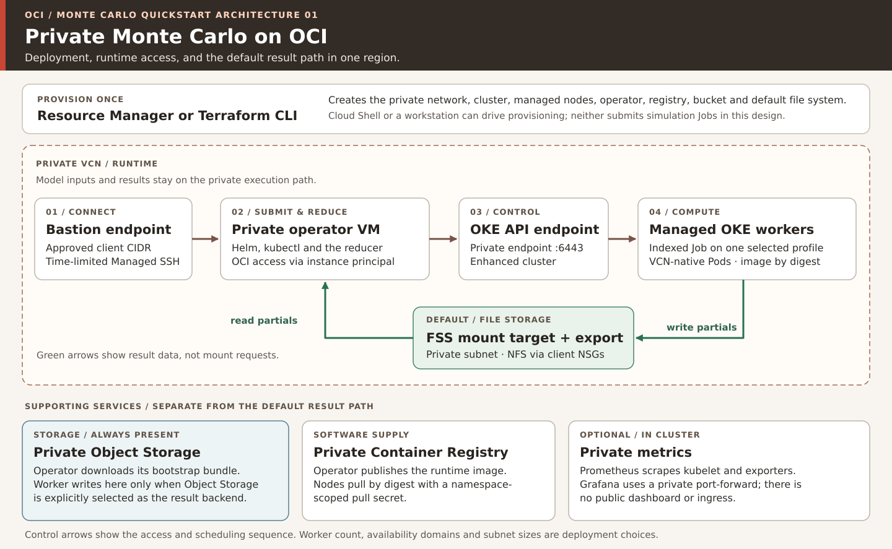
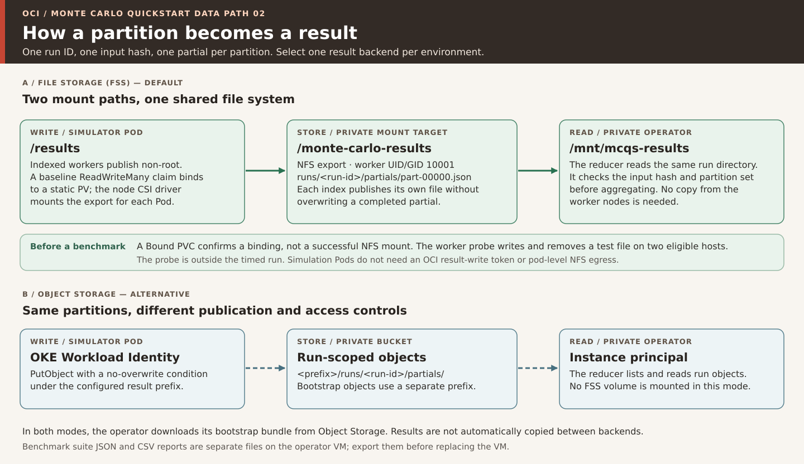

# Architecture: from submission to result

OCI Resource Manager provisions the private environment. To run a simulation, connect through OCI Bastion to the operator VM. The operator submits the work to Kubernetes and reads back the results; Cloud Shell is not on that path.

[Download the overview as PNG](architecture.png) · [Provision the infrastructure and run your first job](provisioning-and-operator.md)

## Follow one run

1. **Prepare the environment.** Terraform creates the private OKE API endpoint, managed worker pool, Bastion, operator, registry and bootstrap bucket. Dedicated benchmark pools are optional. In the default File Storage mode it also creates the filesystem, mount target, export and network rules. The operator downloads its runtime bundle from the private bucket in **both** modes.
2. **Submit the simulation.** From the operator, install the shared Helm baseline, publish or select a digest-pinned image in OCIR, and create the namespace pull secret. Each submission adds an immutable input ConfigMap and an Indexed Job. Kubernetes gives each worker a distinct partition of the model paths; there is no broker to install.
3. **Publish the partitions.** Each worker produces one small JSON partial, not a file per path. With FSS, the node's CSI driver mounts the export for the Pod. The operator mounts that same export independently. With Object Storage, the worker instead calls an OCI API.
4. **Read the result.** The reducer on the operator checks the run ID, input hash and partition set before combining the partials. A derivative run produces a price estimate; an insurance run produces a net liability estimate and event probabilities. A benchmark separately records elapsed time and throughput in reports on the operator, outside the shared export by default.

## Where the partials go

| | File Storage (`fss`, default) | Object Storage (`object_storage`) |
|---|---|---|
| Worker publishes | Under `/results/runs/<run-id>/partials/` via a static read/write-many volume | Under `<prefix>/runs/<run-id>/partials/` in the bucket, using a conditional create |
| Operator reads | Same files under `/mnt/mcqs-results` by default | Lists and reads the run prefix with its instance principal |
| Access boundary | Worker-node and operator network rules and FSS export options; no worker OCI token for results | OKE Workload Identity scoped to the cluster, namespace and ServiceAccount, with a bucket/prefix write policy |
| Before timing a benchmark | The runner tests the claim from two selected worker nodes. A bound claim alone does not prove a worker can write. | No FSS probe; workers need the configured Object Storage access. |

[Download the result flow as PNG](result-delivery.png) · [Mount paths, checks and retention](fss-result-delivery.md)

## Network and ownership

The default VCN is `10.42.0.0/16`. Its private subnets separate the OKE API (`10.42.0.0/28`), workers (`10.42.1.0/24`), Pods (`10.42.16.0/20`), service load balancers (`10.42.32.0/24`), operator (`10.42.48.0/28`), Bastion endpoint (`10.42.49.0/28`) and FSS mount target (`10.42.50.0/28`). The baseline does not publish an application or monitoring ingress.

The operator uses an instance principal for OCI access. The registry pull secret is separate; it is not a worker credential for writing results. For FSS, select `iam_admin`: the Helm baseline needs to create a cluster-scoped PersistentVolume. Worker placement, operator placement and FSS placement can be set independently. Review proposed replacements before applying stack updates.

## Optional layers

- [Benchmark profiles](shape-benchmarking.md) isolate a shape with node labels and taints. The strict suite runs eligible profiles sequentially; an SSH disconnect does not stop a detached suite, but replacing the operator can.
- [Kueue and elastic capacity](grid-elastic-resilience.md) address different waits: Kueue admits a Job against quota; the autoscaler adjusts eligible managed pools when Pods cannot fit. Neither is required for an ordinary Indexed Job.
- [Private monitoring](observability.md) adds Prometheus, Grafana, kube-state-metrics and node-exporter. Use the private operator port-forward for Grafana. Monitoring is opt-in, not a side effect of provisioning a logging group.

For a new environment, [discover a live-supported Kubernetes patch, node shape and image](provisioning-and-operator.md) in the target region. For security review, start with the [threat model](threat-model.md).
