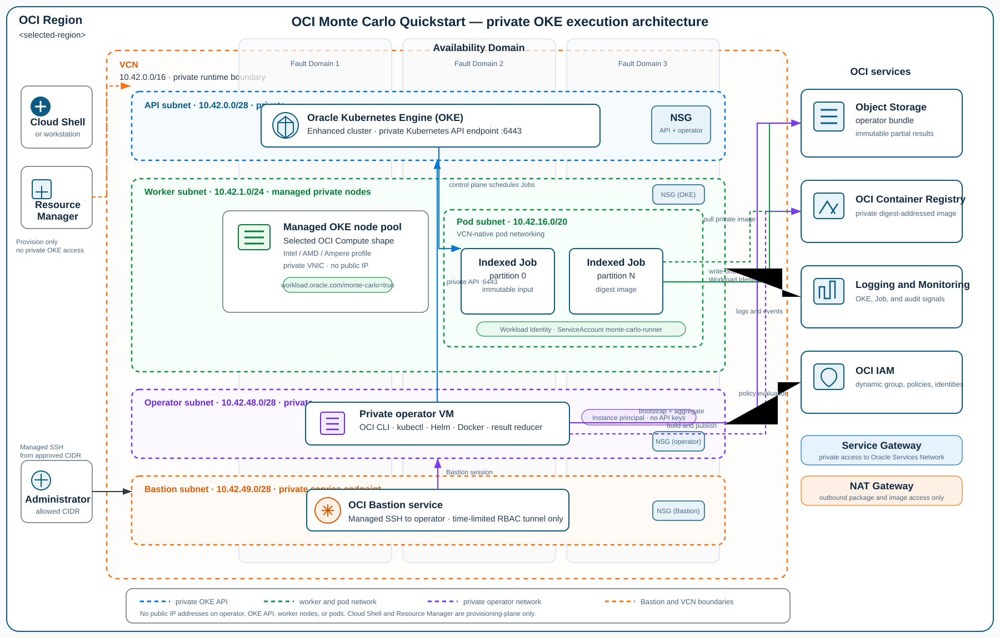
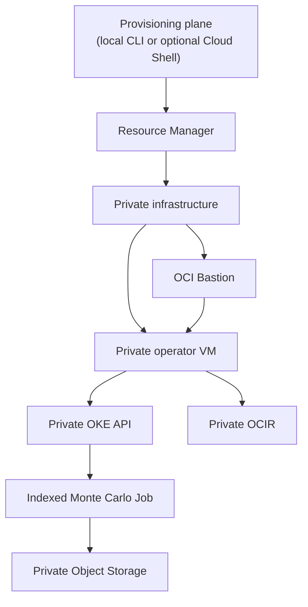

# Architecture and execution model

The quickstart has two intentionally different planes. A local provisioning workstation (with OCI Cloud Shell as an optional convenience) discovers current OCI choices and drives Resource Manager. A Bastion-reached private operator VM executes the runtime against the private cluster.

The diagram uses the quickstart's default private CIDR layout. It is an implementation view, not a capacity topology: the selected worker shape, worker count, and Availability Domain are supplied during provisioning.

Resource Manager creates the infrastructure only: private enhanced OKE, private networking, OCI Bastion, the private operator VM, OCIR, Object Storage, and supporting IAM and observability resources. Image publishing, Helm baseline installation, image-pull-secret creation, job submission, status inspection, and result aggregation all run from the operator VM.

## Live OKE compatibility boundary

The provisioning plane must query OCI immediately before an Apply. Shape availability, OKE supported versions, node images, and capacity are live provider facts rather than a static catalogue. Select a full Kubernetes patch version from the live OKE response and pair it with an image from that same response. The selected node image must match the exact OKE version and selected node architecture (`amd64` for Intel/AMD or `arm64` for Ampere). Neither the Kubernetes version nor node image is an optional default.

## Trust boundaries

- A human uses OCI IAM and a time-limited Bastion Managed SSH session to reach the private operator VM. The operator uses an instance principal, not stored OCI API keys, to generate a kubeconfig for the private OKE endpoint. The stack makes Kubernetes authorization explicit: the quickstart `iam_admin` mode scopes OKE `manage clusters` to this one cluster; the `namespace_rbac` mode retains `use clusters` and requires a one-time namespace-scoped RoleBinding applied by a cluster administrator.
- The provisioning plane has no runtime role. Cloud Shell, when used, is not a private-cluster runtime or an alternate route to the OKE API.
- Pods use only the workload identity defined by the cluster, namespace, and ServiceAccount. They do not receive user API keys or an operator credential.
- OCIR image pulls use a namespace-scoped pull secret. That credential is distinct from the operator's instance principal and must be rotated outside Terraform and source control.
- The Object Storage policy permits creation of results only under the configured run prefix. Workers cannot rewrite a completed partial object.

## Immutable execution and aggregation

The baseline Helm release owns the shared ServiceAccount. Each submission gets a unique run ID, run-specific Helm release, immutable input ConfigMap, and an Indexed Job. The Job is pinned to `repository@sha256:...`, never a mutable image tag, and uses a single node architecture for that run.

Each partition records the canonical input SHA-256, deterministic seed stream, partition index, engine version, elapsed time, and additive payoff moments. It writes a partial object exactly once. The operator aggregates only the partials for one run after checking the run ID, input hash, and expected partition set, then computes the price and confidence interval from those additive moments.

## Why Indexed Jobs, not a permanent broker fleet

European vanilla Monte Carlo simulation is embarrassingly parallel. A Kubernetes Indexed Job supplies stable partition indexes, bounded retries, resource accounting, and a completion signal without exposing a message broker or management console. A managed queue or broker can be added later for a long-lived, multi-tenant submission service; it is intentionally outside this quickstart.

## Observability

Workers write structured result records and errors to standard output/error. Enable OKE cluster logging for the target tenancy and route alerts to the log group created by Terraform. Monitor job failures and duration, Object Storage write failures, OCPU consumption, capacity failures, and Bastion session use as separate signals.
