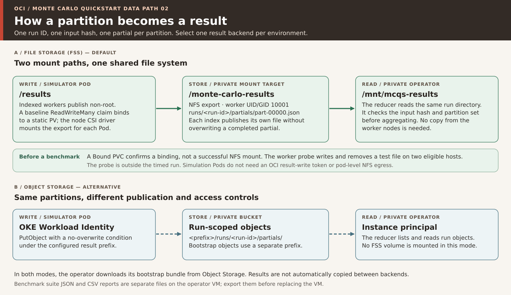

# FSS result delivery

By default, workers and the operator mount the same **OCI File Storage (FSS)** export. Workers do not exchange path data over it: each computes locally and publishes one small JSON partial at the end. The operator combines those partials. Choose one of the two delivery modes per environment.



[Download diagram (PNG)](result-delivery.png) · [See the network overview](architecture.md)


| Mode | Worker publication | Operator aggregation | Pod-level OCI identity |
|---|---|---|---|
| `fss` (default) | Atomic, write-once JSON file in a private shared export | Reads the mounted export | None |
| `object_storage` | Conditional create of a JSON object below the run prefix | Lists and reads the private bucket | Scoped OKE Workload Identity token |

## What is provisioned and what is installed

FSS is the Resource Manager default. Terraform creates:

- An OCI File Storage file system and private mount target in the selected Availability Domain.
- A dedicated FSS subnet (`fss_subnet_cidr`, `/28` by default) with a fixed, optionally configurable mount-target IP.
- NSG rules for the OCI File Storage NFS/RPC ports between the mount target, OKE worker nodes, and private operator VM.
- Export options that accept only the separate operator and worker subnets. The operator initializes the run tree; worker identity is all-squashed to the simulator's non-root UID/GID `10001`.

Operator bootstrap mounts that export at `fss_operator_mount_path`. Later, `operator/install-runtime.sh` installs the static Kubernetes PersistentVolume and its `ReadWriteMany` claim. The binding names include the filesystem identity; they do not transfer results to a replacement filesystem.

Object Storage remains private in FSS mode because it delivers the versioned operator bootstrap bundle. The worker Object Storage policy and the operator result-reader policy are not created in FSS mode, regardless of their individual policy toggles.

## Run flow

1. Keep the default `result_delivery_mode = "fss"`.
2. Connect to the private operator and run `./operator/doctor.sh`. It checks the operator mount and the `fss.csi.oraclecloud.com` driver.
3. Run `./operator/install-runtime.sh`. The baseline chart creates the static PV and namespace-scoped claim for this filesystem generation.
4. Build the image and create the OCIR pull secret as normal.
5. Submit an example, grid, or benchmark with the normal operator commands. No separate FSS command is needed.

Before a benchmark begins, the benchmark runner verifies the FSS claim on two selected worker nodes using the same immutable image, node selector, and tolerations as the simulation Job. This confirms image access, CSI mounting, and write permissions before timing begins. The check is not included in benchmark timing.

FSS mode requires `operator_kubernetes_access_mode = "iam_admin"`. The baseline creates a static, cluster-scoped PV and a namespace-scoped claim. The quickstart intentionally keeps `namespace_rbac` namespace-only, so Terraform rejects the incompatible combination during planning instead of deferring the error to a Helm install.

When converting an existing quickstart environment from Object Storage to FSS, also increment `operator_bootstrap_generation` in the Resource Manager inputs. That deliberately replaces the operator VM so cloud-init installs `nfs-utils`, mounts the new export, and writes the new runtime profile. Save any operator-local reports first. Changing the backend does not migrate earlier runs.

### Find a partition

Partition zero of a run is the **same file** at these two locations (default mount paths):

| View | Path |
|---|---|
| Simulator container | `/results/runs/<run-id>/partials/part-00000.json` |
| Private operator | `/mnt/mcqs-results/runs/<run-id>/partials/part-00000.json` |

From the operator, use these read-only checks after installing the baseline:

```bash
source /etc/profile.d/mcqs-runtime.sh
findmnt --mountpoint "$MCQS_FSS_RESULTS_DIR"
kubectl -n monte-carlo get pvc "$MCQS_FSS_PERSISTENT_VOLUME_CLAIM_NAME"
```

The first verifies the operator mount; the second shows whether the Kubernetes claim is bound. Neither proves a mount works **on the workers**. The benchmark probe tests that separately. If it fails, inspect the probe Pod's Events for image, scheduling or CSI mount errors before starting a timed run.

The result writer creates a temporary file, syncs it, then atomically links it to the final name. A retry can reuse a result only when its deterministic fields match; it cannot overwrite a completed partition. The reducer reads only the requested run’s `part-*.json` files and performs the usual run ID, input hash, and full partition-set validation.

## Operational considerations

- The FSS CSI driver is part of the OKE storage integration. Keep it available and validate its node components during OKE upgrades.
- The Kubernetes PV capacity is a declaration required by Kubernetes. OCI File Storage is elastic; use OCI monitoring and quotas/cost governance rather than this field as a capacity boundary.
- Keep the mount target in its own subnet with enough free IP addresses. OCI recommends a separate mount-target subnet and requires multiple free IP addresses for high availability.
- The project mounts FSS with `nosuid,nodev,noexec` on the operator. Worker containers remain non-root, drop Linux capabilities, and have a read-only root filesystem.
- The static volume uses the Kubernetes `Retain` reclaim policy. That is not a filesystem backup and does not protect the OCI filesystem from a Terraform Destroy. Atomic publication prevents accidental overwrites by the writer; it is not regulatory write-once storage.
- Suite JSON/CSV reports live on the operator under `benchmark-results/suites/` by default, not on FSS. Export reports you want to keep before replacing the VM.
- Treat FSS run directories as operational result data. Define backups, retention, deletion approval, and any archive-to-Object-Storage process appropriate to the customer’s regulatory requirements.
- FSS is a shared filesystem, not a parallel filesystem. It is suitable for shared metadata, inputs, checkpoints, and result files. For high-throughput, metadata-intensive simulation checkpoints or large scenario datasets, evaluate OCI Lustre separately and keep the same per-run immutability and retention model.
